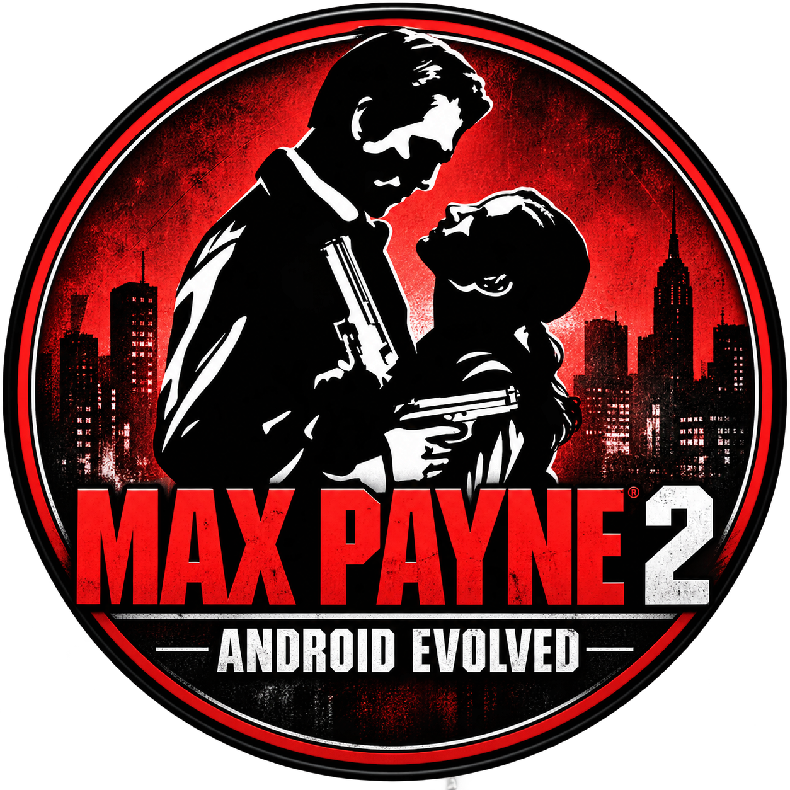

<p align="center">
  
</p>

<h1 align="center">Max Payne 2: Android Evolved</h1>

<p align="center">
  <b>An experimental native port of Max Payne 2 (PC) to Android ARM64 through static recompilation.</b><br>
  <a href="README.md">Leer en español</a>
</p>

> [!IMPORTANT]
> **This repository does not include the game.** You need your own copy of the PC version. It contains no
> executables, DLLs, `.ras` archives, videos, audio or recompiled code, and neither does the APK.

## What it is

The project translates the PC game's x86 code to C, compiles it for ARM64 and runs it on Android on top of a
custom Win32 runtime. It does not use Wine, Box64, Winlator or QEMU: the logic, physics, levels and Bullet Time
are the original game's, not reimplementations.

```
x86 PC game → PCRecomp → C → custom Win32 runtime → Android NDK ARM64 → DXVK/Vulkan → native APK
```

- **Graphics:** Direct3D 8 → DXVK's D3D8 frontend → DXVK-native D3D9 → Vulkan.
- **Sound:** DirectSound → custom mixer → AAudio.
- **Widescreen:** ThirteenAG's WidescreenFix runs recompiled, just as it does on PC.

## Status

**Experimental. It has been played on one device only:** Samsung Galaxy S25 Ultra (SM-S938B, Adreno 830, 2340×1080).

| Area | Status |
|---|---|
| Boot and Bink startup videos | Works |
| Main menu in Spanish | Works; about 30 s to reach it |
| Graphic novel and first cutscene | Works, with WidescreenFix |
| First level: walking and moving the camera | Works at 60 FPS |
| Engine sound | The mixer plays voices; quality not assessed in detail |
| Touch HUD and menu cursor | Works |
| Launcher, languages and controls editor | Implemented; testing incomplete |
| Shooting, Bullet Time, Shootdodge | Implemented; **unconfirmed** |
| Saving and loading | "Resume" loads a saved game; **saving unconfirmed** |
| Full campaign | **Untested** |

Technical details are in [docs/PROGRESS.md](docs/PROGRESS.md) and blockers in [docs/BLOCKERS.md](docs/BLOCKERS.md)
(both in Spanish).

## Requirements to play

- Android 10 or later (API 29), ARM64 and Vulkan 1.1. Only tested on Vulkan 1.3.
- Your copy of Max Payne 2 for PC, specifically the same version the code was generated from
  (SHA-256 hashes are in [config/pc/modules.json](config/pc/modules.json)).
- `scripts/MaxPayne2.WidescreenFix.asi` and its `.ini`, same version, for widescreen.
- About 1.5 GB free on internal storage.

### Installation

1. Copy the game folder to **Internal storage/`mp2`**, so that `mp2/MaxPayne2.exe` exists:
   ```
   adb push "Max Payne 2 The Fall of Max Payne/." /storage/emulated/0/mp2/
   ```
2. Install the APK. For now you have to build it: the project does not publish releases.
3. Open the app, grant the file permission and tap **PLAY**.

## Touch controls

Each button sends the key or mouse button the game assigns by default.

| Control | In-game action |
|---|---|
| Joystick | Move (W, A, S, D) |
| Drag on the rest of the screen | Look |
| Pistol | Shoot |
| Hourglass | Bullet Time |
| Sideways dive | Shootdodge (left Shift) |
| Jump / Reload / Hand | Jump / Reload / Use |
| Painkillers / Weapons / Crosshair | Painkillers / Next weapon / Sniper zoom |
| Pause | Esc: menu and skipping cutscenes |

Buttons appear only during gameplay, except Pause, which is always visible. Outside gameplay a tap counts as a
click. The **Controls** button lets you move and resize them during play, and the launcher offers the same editor.

## Building from source

It has only been built on Windows. You need Python 3 (`requirements-tools.txt`), Visual Studio with MSVC and CMake,
the Android SDK with NDK `28.2.13676358` and CMake `3.30.5`, and Android Studio's JDK: Gradle 8.9 does not run on Java 26.

Some dependencies cannot yet be obtained from this repository alone:

- **PCRecomp** in `external/pcrecomp`: branch and commit in [config/pc/toolchain.json](config/pc/toolchain.json), plus
  `patches/pcrecomp/0001-seh-frames-and-or-xor-conditions.patch`.
- **DXVK port** in `work/pc/dxvk_android`: `scripts/pc_recomp/prepare_dxvk_android.sh` takes it from a local copy of
  `nfsu2-recompiled`, a sibling project that is not part of this repository.

With the game installed in `Max Payne 2 The Fall of Max Payne/`:

```powershell
# 1. Generate the recompiled code in work/pc/gen (never committed)
python scripts\pc_recomp\recompile_modules.py --phase all
python scripts\pc_recomp\merge_dispatch.py work\pc\gen\merged

# 2. Optional: check it on Windows, in a 960×540 window
powershell -File scripts\pc_recomp\boot_host.ps1 -Log test -AllowWindow -Widescreen

# 3. Build the APK
cd android
$env:JAVA_HOME = "C:\Program Files\Android\Android Studio\jbr"
.\gradlew --no-daemon :app:assembleDebug
```

The first ARM64 build took about 13 minutes on a 16-core machine with 8 parallel jobs.

## Still to test

**Gameplay**
- [ ] Shooting, reloading and switching weapons, with damage to enemies.
- [ ] Real Bullet Time and Shootdodge, including animations and the meter.
- [ ] Painkillers, jumping, using objects and sniper zoom.
- [ ] Enemy AI, object physics and ragdolls in combat.
- [ ] Full campaign, level transitions and the ending.
- [ ] Extra modes: Dead Man Walking, New York Minute, etc.

**Saves and system**
- [ ] Saving, autosave and loading after closing the app.
- [ ] The game's options menu: video, audio and controls.
- [ ] Leaving and returning to the app mid-game, and exiting from the menu.
- [ ] `previously.bik` and `credits.bik` videos.
- [ ] Long sessions: temperature, battery, memory and stability.

**Launcher and controls**
- [ ] Controls editor, in the launcher and during play.
- [ ] Language switching. English hides `MP2_Spanish.ras` and should show the base language; unconfirmed.
- [ ] Resolution, FPS limit, field of view and widescreen options.
- [ ] What `-skipstartup` ("Skip videos") and `-disable3dpreloads` ("Fast loading") actually do.

**Compatibility**
- [ ] Other phones and GPUs: Mali, Xclipse, older Adreno.
- [ ] Devices with exactly Vulkan 1.1 and other aspect ratios.
- [ ] The game's HUD and cutscenes in every scene with WidescreenFix.

## Still to implement

**Controls**
- [ ] **Physical gamepad:** the native code exists but still has to be connected from Java.
- [ ] Touch buttons for crouching, melee, previous weapon and direct weapon selection.
- [ ] On-screen keyboard for in-game text entry, if the game asks for it.
- [ ] Action remapping and control profiles.

**Sound**
- [ ] Complete DirectSound 3D: distance attenuation and panning exist, but not Doppler, cones or factors.
- [ ] EAX reverb: the engine is told it is unsupported.

**Language**
- [ ] Portuguese in-game: needs language data this copy does not include. The launcher is translated.

**App and distribution**
- [ ] Publish a signed APK and releases.
- [ ] A wizard to copy the game and check its version, with clear error messages.
- [ ] Game folder picker; the path is currently fixed.
- [ ] Custom Vulkan drivers, disabled in this build.

**Technical**
- [ ] Loading performance: the CRT and I/O remain recompiled or emulated.
- [ ] 80-bit x87: the model uses 64-bit `double`, which may affect physics in edge cases.
- [ ] Review the outstanding `msvcr71` x87 divergences ([docs/BLOCKERS.md](docs/BLOCKERS.md)).
- [ ] Win32 dialogs and GDI drawing: unavailable on Android; the startup dialog is avoided with preset settings.
- [ ] Remove unused code inherited from the NFS Carbon port, such as networking and NFSCO.
- [ ] A reproducible build without the sibling project, and automated on-device tests.
- [ ] Update older documentation in `docs/`, some of which predates the Android port.

## Repository layout

| Path | Contents |
|---|---|
| `android/` | App: launcher, HUD and native runtime (`app/src/main/cpp`) |
| `desktop/pc_host/` | Windows host for validating and diagnosing on PC |
| `scripts/pc_recomp/`, `scripts/pc_analysis/` | Recompilation and binary analysis |
| `config/pc/` | Modules, plugin patches and input scripts |
| `src/runtime/pc/` | Code shared between hosts |
| `third_party/dxvk_d3d8/` | DXVK's D3D8 frontend (zlib license) |
| `archive/ps2_reference/` | Earlier attempt with the PS2 version ([README](archive/ps2_reference/README_PS2.md), in Spanish) |
| `work/` | Generated locally from the game; ignored by Git |

## Credits and legal notice

A fan project, neither affiliated with nor endorsed by Remedy Entertainment or Rockstar Games.
*Max Payne* and its assets belong to their respective owners.

It builds on [PCRecomp](https://github.com/sp00nznet/pcrecomp), [DXVK](https://github.com/doitsujin/dxvk) and
[ThirteenAG](https://github.com/ThirteenAG/WidescreenFixesPack)'s WidescreenFix. The runtime derives from a
*Need for Speed Carbon* port. Each component keeps its own license.
