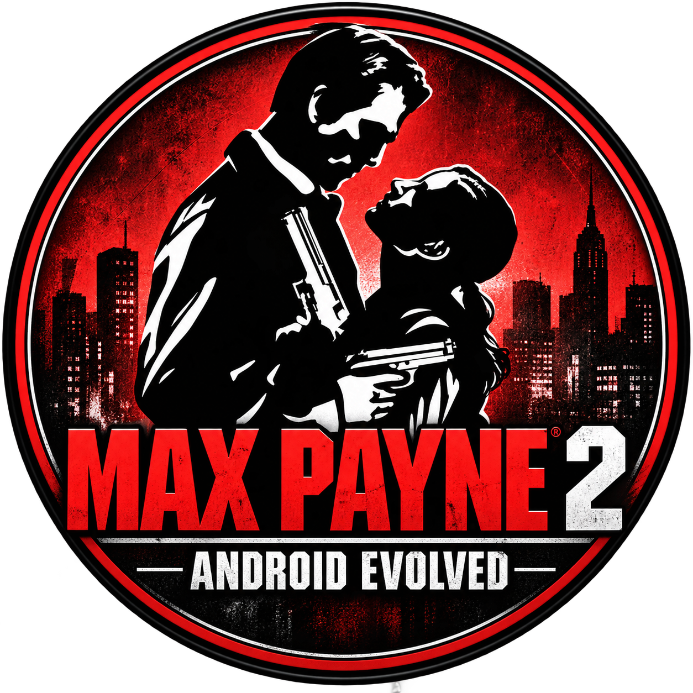

<p align="center">
  
</p>

<h1 align="center">Max Payne 2: Android Evolved</h1>

<p align="center">
  <b>An experimental native port of Max Payne 2 (PC) to Android ARM64 through static recompilation.</b><br>
  <a href="README.md">Leer en español</a>
</p>

> [!IMPORTANT]
> **This repository does not include the game.** You need your own copy of the PC version. It contains no
> PC game executables, DLLs, `.ras` archives, videos, audio or recompiled game code. The APK includes
> recompiled code linked into the native runtime, but does not include the game data files.

## What it is

The project translates the PC game's x86 code to C, compiles it for ARM64 and runs it on Android on top of a
custom Win32 runtime. It does not use Wine, Box64, Winlator or QEMU: the logic, physics, levels and Bullet Time
are the original game's, not reimplementations.

```
x86 PC game → PCRecomp → C → custom Win32 runtime → Android NDK ARM64 → DXVK/Vulkan → native APK
```

- **Graphics:** Direct3D 8 → DXVK's D3D8 frontend → DXVK-native D3D9 → Vulkan.
- **Sound:** DirectSound → custom mixer → AAudio.
- **Widescreen:** ThirteenAG's WidescreenFix runs recompiled, just as it does on PC.

## Download

**[Download the 0.22-pc ARM64 APK](https://github.com/codepdbh/mp2-androidevolved/releases/download/v0.22-pc/MaxPayne2-AndroidEvolved-0.22-pc-arm64-v8a.apk)** | [Release notes and SHA-256](https://github.com/codepdbh/mp2-androidevolved/releases/tag/v0.22-pc)

Release 0.22-pc, with signed ARM64 and ARM32 APKs. The port remains experimental. Its signature, version and package alignment
were verified; this Release build has not yet been tested on a device. The gameplay results below
come from earlier development builds.

This version fixes the blue screen when reopening the game and routes error reports to the main repository (issue #5).

### ARM32: fully experimental

[Download the experimental 32-bit APK](https://github.com/codepdbh/mp2-androidevolved/releases/download/v0.22-pc/MaxPayne2-AndroidEvolved-0.22-pc-armeabi-v7a-experimental.apk).
**It may fail to start or crash while loading. It has not been tested on a device.**
Requires Android 10 or later, support for `armeabi-v7a` apps and a 32-bit Vulkan driver compatible with Vulkan 1.1.
Some ARM64 phones cannot run ARM32 apps. The guest address space is limited to 1 GB;
this is not a confirmed option for older phones.
It uses the same package and signing key as ARM64: preserve your data before switching variants.

## Status

**Experimental. It has been played on one device only:** Samsung Galaxy S25 Ultra (SM-S938B, Adreno 830, 2340×1080).

| Area | Status |
|---|---|
| Boot and Bink startup videos | Works |
| Main menu in Spanish | Works; about 30 s to reach it |
| Graphic novel and first cutscene | Works, with WidescreenFix |
| First level: walking and moving the camera | Works at 60 FPS |
| Engine sound | The mixer plays voices; quality not assessed in detail |
| Touch HUD and menu cursor | Works |
| Launcher, languages and controls editor | Implemented; testing incomplete |
| Shooting, Bullet Time, Shootdodge | Implemented; **unconfirmed** |
| Saving and loading | "Resume" loads a saved game; **saving unconfirmed** |
| Full campaign | **Untested** |

Technical details are in [docs/PROGRESS.md](docs/PROGRESS.md) and blockers in [docs/BLOCKERS.md](docs/BLOCKERS.md)
(both in Spanish).

## Requirements to play

- Android 10 or later (API 29), ARM64 and Vulkan 1.1. Only tested on Vulkan 1.3.
- Your copy of Max Payne 2 for PC, specifically the same version the code was generated from
  (SHA-256 hashes are in [config/pc/modules.json](config/pc/modules.json)).
- `scripts/MaxPayne2.WidescreenFix.asi` and its `.ini`, same version, for widescreen.
- Space for your complete installation and the app. The tested copy occupies about 1.7 GB;
  at least **3 GB of free space** is recommended before copying and installing.

## Install the app and copy your game data

### 1. Prepare your original PC copy

Install your original **Windows copy of Max Payne 2** from your disc or the store where you purchased it.
Find its installed folder containing `MaxPayne2.exe`, the `.ras` archives and the engine DLLs.
You need the installed files: an installer, an unextracted ZIP or an ISO alone is not a prepared game folder.
PS2 and Xbox data cannot be used with this version of the port.

The current recompilation corresponds to the binaries listed in [config/pc/modules.json](config/pc/modules.json).
Not every edition, update or modified executable is compatible. To compare your executable, run PowerShell
from your game folder:

```powershell
Get-FileHash .\MaxPayne2.exe -Algorithm SHA256
```

The executable used for this release has this SHA-256:

```text
1e25cafc37174a607b58a38dfac796056f0f38f35d253b0b2d7677f9bd7bd010
```

Widescreen mode expects the **2016** `scripts/MaxPayne2.WidescreenFix.asi` and its `.ini`.
The mod's official project is [ThirteenAG/WidescreenFixesPack](https://github.com/ThirteenAG/WidescreenFixesPack/releases/tag/mp2),
but today's download may differ: compare the compatible build's hash in `config/pc/modules.json`.
Recent mod packs are not guaranteed to work with this recompilation. If you do not have the compatible fix,
disable **WidescreenFix** in the launcher; this has aspect-ratio limitations and differs from the tested widescreen setup.

### 2. Copy over USB to internal storage

1. Connect your phone to the PC and select **File transfer** for the USB connection.
2. Open the phone's internal shared storage and create a folder named **`mp2`** at its root.
3. Copy **all contents of your installed game folder** into `mp2`, preserving names and subfolders.
   Include the DLLs, every `.ras` archive from your installation, and the `e2driver`, `movies` and `scripts`
   folders when present. Copying just the executable is not enough.
4. Wait for the transfer to finish. `MaxPayne2.exe` must be directly inside `mp2`.

Example layout; retain the other files from your installation too:

```text
Internal storage/
└── mp2/
    ├── MaxPayne2.exe
    ├── e2mfc.dll
    ├── ... other game DLLs ...
    ├── MP2_Init.ras
    ├── MP2_Data.ras
    ├── MP2_Levels_A.ras
    ├── MP2_Levels_B.ras
    ├── MP2_Levels_C.ras
    ├── MP2_Music.ras
    ├── MP2_Sounds.ras
    ├── MP2_Spanish.ras             ← if your copy includes Spanish
    ├── e2driver/
    │   └── e2_d3d8_driver_mfc.dll
    ├── movies/
    └── scripts/
        ├── MaxPayne2.WidescreenFix.asi
        └── MaxPayne2.WidescreenFix.ini
```

The exact Android path is **`/storage/emulated/0/mp2/MaxPayne2.exe`**.
Avoid an extra folder such as `mp2/Max Payne 2 The Fall of Max Payne/MaxPayne2.exe`.
Use internal shared storage, outside `Android/data` and Downloads. Keep the language files supplied with your copy:
choosing another language in the launcher does not download its data. Back up an existing `mp2` folder
with saves or settings before replacing files.

**ADB alternative**, if you already have Platform Tools and USB debugging enabled:

```powershell
adb shell mkdir -p /storage/emulated/0/mp2
# Replace this path with your original copy's installed folder.
adb push "C:/Games/Max Payne 2 The Fall of Max Payne/." /storage/emulated/0/mp2/
adb shell ls /storage/emulated/0/mp2/MaxPayne2.exe
```

### 3. Install the APK and start

1. Download the **ARM64 APK** from [release 0.22-pc](https://github.com/codepdbh/mp2-androidevolved/releases/tag/v0.22-pc).
   Use ARM32 only if you need that architecture and accept its experimental limitations.
2. Open the APK on your phone and install it. Android may ask you to allow installation from the browser
   or file manager you are using.
3. Open **Max Payne 2: Android Evolved**, tap **PLAY** and grant the requested file access.
   On Android 11 or later the app uses all-files access to read the `mp2` folder.
4. Return to the app, check that it finds `Internal storage/mp2`, and tap **PLAY**.
   Choose a language present in your copy and keep WidescreenFix enabled only with the compatible files.

The launcher's data indicator detects the executable's presence; it does not validate the whole installation's
integrity or compatibility. The game checks additional files at startup.

If Android rejects the update because an installed development APK uses a different signature, preserve your
data and uninstall that APK before installing the release. The release includes `SHA256SUMS.txt` to verify the download.

### If it does not start

| Message or problem | What to check |
|---|---|
| Cannot find `mp2/MaxPayne2.exe` | Exact path, extra nested folders and file access permission. |
| A file is missing from `mp2` | Copy the named file again from your complete installation; preserve `e2driver`. |
| Executable does not match the recompiled code | Compare the version and hashes in `config/pc/modules.json`; another edition may be incompatible. |
| WidescreenFix error | Check the 2016 version and its `.asi` and `.ini` in `mp2/scripts`, or disable the option to test. |
| Missing language, audio, video or level | Check that all `.ras` archives and your installation's subfolders finished copying. |
| Crash or black screen after these checks | Open **Errors** in the launcher and prepare a report containing your device, settings and log. |

## Error reports

Since 0.21-pc, the launcher can prepare error reports from the **Errors** section. On Android 11 or later,
it can also notify you after an abnormal exit. Reports are saved to `mp2/logs`, copied to the clipboard
and opened in GitHub Issues for you to review and submit; they are not submitted automatically.

## Touch controls

Each button sends the key or mouse button the game assigns by default.

| Control | In-game action |
|---|---|
| Joystick | Move (W, A, S, D) |
| Drag on the rest of the screen | Look |
| Pistol | Shoot |
| Hourglass | Bullet Time |
| Sideways dive | Shootdodge (left Shift) |
| Jump / Reload / Hand | Jump / Reload / Use |
| Painkillers / Weapons / Crosshair | Painkillers / Next weapon / Sniper zoom |
| Pause | Esc: menu and skipping cutscenes |

Buttons appear only during gameplay, except Pause, which is always visible. Outside gameplay a tap counts as a
click. The **Controls** button lets you move and resize them during play, and the launcher offers the same editor.

## Building from source

It has only been built on Windows. You need Python 3 (`requirements-tools.txt`), Visual Studio with MSVC and CMake,
the Android SDK with NDK `28.2.13676358` and CMake `3.30.5`, and Android Studio's JDK: Gradle 8.9 does not run on Java 26.

Some dependencies cannot yet be obtained from this repository alone:

- **PCRecomp** in `external/pcrecomp`: branch and commit in [config/pc/toolchain.json](config/pc/toolchain.json), plus
  `patches/pcrecomp/0001-seh-frames-and-or-xor-conditions.patch`.
- **DXVK port** in `work/pc/dxvk_android`: `scripts/pc_recomp/prepare_dxvk_android.sh` takes it from a local copy of
  `nfsu2-recompiled`, a sibling project that is not part of this repository.

With the game installed in `Max Payne 2 The Fall of Max Payne/`:

```powershell
# 1. Generate the recompiled code in work/pc/gen (never committed)
python scripts\pc_recomp\recompile_modules.py --phase all
python scripts\pc_recomp\merge_dispatch.py work\pc\gen\merged

# 2. Optional: check it on Windows, in a 960×540 window
powershell -File scripts\pc_recomp\boot_host.ps1 -Log test -AllowWindow -Widescreen

# 3. Build the APK
cd android
$env:JAVA_HOME = "C:\Program Files\Android\Android Studio\jbr"
.\gradlew --no-daemon :app:assembleDebug
```

The first ARM64 build took about 13 minutes on a 16-core machine with 8 parallel jobs.

To build the experimental ARM32 variant, run from `android/`:

```powershell
.\gradlew --no-daemon -PexperimentalArm32=true :app:assembleRelease
```

This command produces an unsigned Release unless you configure your own signing key. The default build
still targets ARM64; the published ARM32 APK uses the same signing key as the ARM64 APK.

## Still to test

**Gameplay**
- [ ] Shooting, reloading and switching weapons, with damage to enemies.
- [ ] Real Bullet Time and Shootdodge, including animations and the meter.
- [ ] Painkillers, jumping, using objects and sniper zoom.
- [ ] Enemy AI, object physics and ragdolls in combat.
- [ ] Full campaign, level transitions and the ending.
- [ ] Extra modes: Dead Man Walking, New York Minute, etc.

**Saves and system**
- [ ] Saving, autosave and loading after closing the app.
- [ ] The game's options menu: video, audio and controls.
- [ ] Leaving and returning to the app mid-game, and exiting from the menu.
- [ ] `previously.bik` and `credits.bik` videos.
- [ ] Long sessions: temperature, battery, memory and stability.

**Launcher and controls**
- [ ] Physical gamepad: implemented; its actions still need on-device validation.
- [ ] Controls editor, in the launcher and during play.
- [ ] Language switching. English hides `MP2_Spanish.ras` and should show the base language; unconfirmed.
- [ ] Resolution, FPS limit, field of view and widescreen options.
- [ ] What `-skipstartup` ("Skip videos") and `-disable3dpreloads` ("Fast loading") actually do.

**Compatibility**
- [ ] Other phones and GPUs: Mali, Xclipse, older Adreno.
- [ ] Devices with exactly Vulkan 1.1 and other aspect ratios.
- [ ] The game's HUD and cutscenes in every scene with WidescreenFix.

## Still to implement

**Controls**
- [ ] Touch buttons for crouching, melee, previous weapon and direct weapon selection.
- [ ] On-screen keyboard for in-game text entry, if the game asks for it.
- [ ] Action remapping and control profiles.

**Sound**
- [ ] Complete DirectSound 3D: distance attenuation and panning exist, but not Doppler, cones or factors.
- [ ] EAX reverb: the engine is told it is unsupported.

**Language**
- [ ] Portuguese in-game: needs language data this copy does not include. The launcher is translated.

**App and distribution**
- [x] Publish a signed APK: [0.22-pc](https://github.com/codepdbh/mp2-androidevolved/releases/tag/v0.22-pc).
- [ ] A wizard to copy the game and check its version, with clear error messages.
- [ ] Game folder picker; the path is currently fixed.
- [ ] Custom Vulkan drivers, disabled in this build.

**Technical**
- [ ] Loading performance: the CRT and I/O remain recompiled or emulated.
- [ ] 80-bit x87: the model uses 64-bit `double`, which may affect physics in edge cases.
- [ ] Review the outstanding `msvcr71` x87 divergences ([docs/BLOCKERS.md](docs/BLOCKERS.md)).
- [ ] Win32 dialogs and GDI drawing: unavailable on Android; the startup dialog is avoided with preset settings.
- [ ] Remove unused code inherited from the NFS Carbon port, such as networking and NFSCO.
- [ ] A reproducible build without the sibling project, and automated on-device tests.
- [ ] Update older documentation in `docs/`, some of which predates the Android port.

## Repository layout

| Path | Contents |
|---|---|
| `android/` | App: launcher, HUD and native runtime (`app/src/main/cpp`) |
| `desktop/pc_host/` | Windows host for validating and diagnosing on PC |
| `scripts/pc_recomp/`, `scripts/pc_analysis/` | Recompilation and binary analysis |
| `config/pc/` | Modules, plugin patches and input scripts |
| `src/runtime/pc/` | Code shared between hosts |
| `third_party/dxvk_d3d8/` | DXVK's D3D8 frontend (zlib license) |
| `archive/ps2_reference/` | Earlier attempt with the PS2 version ([README](archive/ps2_reference/README_PS2.md), in Spanish) |
| `work/` | Generated locally from the game; ignored by Git |

## Credits and legal notice

A fan project, neither affiliated with nor endorsed by Remedy Entertainment or Rockstar Games.
*Max Payne* and its assets belong to their respective owners.

It builds on [PCRecomp](https://github.com/sp00nznet/pcrecomp), [DXVK](https://github.com/doitsujin/dxvk) and
[ThirteenAG](https://github.com/ThirteenAG/WidescreenFixesPack)'s WidescreenFix. The runtime derives from a
*Need for Speed Carbon* port. Each component keeps its own license.
