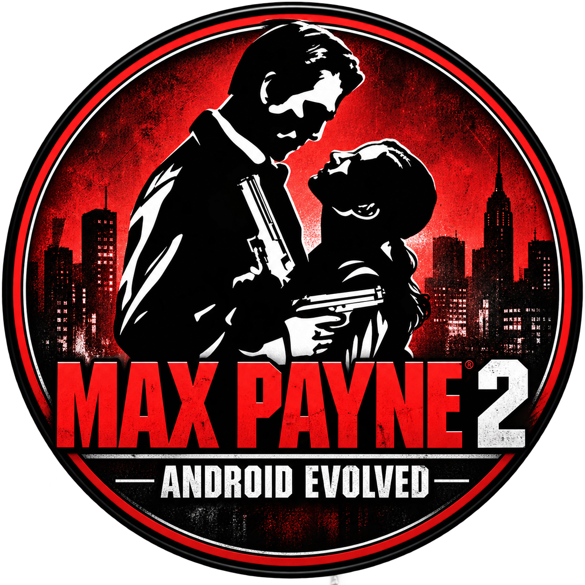

<p align="center">
  
</p>

<h1 align="center">MP2R — Max Payne 2: Android Evolved</h1>

<p align="center">
  <b>Port nativo experimental de Max Payne 2 (PS2, PAL SLES-52256) a Android ARM64<br>
  mediante recompilación estática del ejecutable original.</b>
</p>

<p align="center">
  
  
  
  
  
</p>

---

> [!IMPORTANT]
> **Todavía no es jugable.** No hay menú, niveles, renderer, audio ni gameplay.
> La APK actual es una herramienta de diagnóstico que ejecuta el arranque
> original recompilado y prueba los controles táctiles.

## ¿Qué es esto?

MP2R no es un emulador. El ELF MIPS R5900 del juego se traduce a C++ con
[PS2Recomp](https://github.com/ran-j/PS2Recomp), se compila de forma nativa para
AArch64 y se ejecuta sobre un runtime propio que implementa, uno por uno y con
pruebas, los contratos del kernel EE que el juego necesita de verdad.

Principios del proyecto:

- **Nada de valores inventados.** Si el juego toca un servicio que aún no
  existe, la ejecución se detiene en el PC exacto. No se devuelven ceros para
  saltarse una inicialización.
- **El código original no se parchea.** Los cuerpos C++ generados se compilan
  tal cual; el runtime solo aporta la plataforma.
- **Mismo resultado en Windows x64 y ARM64.** Cada hito se valida comparando
  trazas idénticas en el host y en un teléfono real.
- **Sin material comercial en el repositorio.** Ni ISO, ni extracciones, ni C++
  generado a partir del ELF, ni binarios derivados.

## Estado actual

| Área | Estado |
|---|---|
| Identificación de la ISO y extracción (504 archivos, SHA-256) | ✅ Validada |
| Mapa de funciones con Ghidra + EE (17 149 funciones) | ✅ Completado |
| Recompilación del subconjunto de arranque (51 funciones, 182 PCs) | ✅ Sin instrucciones no manejadas |
| Carga del ELF real en RAM invitada desde la APK | ✅ Funciona en el dispositivo |
| Semáforos EE, callbacks de syscall, tabla de kernel | ✅ Implementados y con tests |
| Temporizadores, alarmas e INTC (sin entrega de IRQ) | 🟡 Parcial |
| Hilos EE y planificador cooperativo | 🟡 Parcial: primer hilo auxiliar ejecutado |
| `GetOsdConfigParam` (syscall `0x4B`, PC `0x0010D698`) | ⛔ **Bloqueo actual** |
| Servicios IOP / SIF RPC, GS / VU, audio | ⏳ Pendiente |
| Texturas RenderWare (285 TXD decodificados con librw) | 🟡 Lectura, sin renderer |
| HUD táctil: multitouch, editor de posiciones y pictogramas propios | ✅ Probado en el teléfono |
| Menú, niveles, Bullet Time, Shootdodge | ⏳ Pendiente |

El historial completo está en [docs/PROGRESS.md](docs/PROGRESS.md) y la última
iteración en [docs/ITERATION_05.md](docs/ITERATION_05.md).

## Arquitectura

```
 Max Payne 2.iso (copia propia, nunca en Git)
        │  scripts/analyze_iso.py      → extracción + verificación SHA-256
        ▼
 SLES_522.56 (ELF MIPS R5900)
        │  Ghidra + ghidra-emotionengine-reloaded → mapa de funciones
        │  PS2Recomp                              → C++ generado (privado)
        ▼
 ┌──────────────────────────────────────────────────────────┐
 │  src/runtime/   runtime nativo MP2R                       │
 │   ├─ dispatcher cooperativo por PC                        │
 │   ├─ ee_threads.h     hilos, prioridades, contextos R5900 │
 │   ├─ ee_semaphores.h  semáforos EE (syscall 0x40…0x44)    │
 │   ├─ ee_timer3.h      contadores y alarmas                │
 │   ├─ ee_intc.h        controlador de interrupciones       │
 │   └─ kernel_syscall_table.h                               │
 │  src/input/     MP2 Touch Engine (entrada semántica)      │
 └──────────────────────────────────────────────────────────┘
        │  NDK r28 · CMake · Ninja · JNI
        ▼
 android/   APK de diagnóstico (Java + native_bridge.cpp)
```

## Estructura del repositorio

| Ruta | Contenido |
|---|---|
| [`src/runtime/`](src/runtime) | Runtime nativo: kernel EE, hilos, semáforos, timers, INTC |
| [`src/input/`](src/input) | Motor táctil multitouch independiente del juego |
| [`android/`](android) | Proyecto Gradle de la APK, puente JNI e iconos |
| [`scripts/`](scripts) | Análisis de la ISO, Ghidra, recompilación, builds y despliegue |
| [`config/`](config) | Configuraciones de PS2Recomp, Ghidra y dependencias fijadas |
| [`tests/`](tests) | CTest (C++) y unittest (Python) |
| [`docs/`](docs) | Informes de iteración, contratos del kernel y bloqueos |

## Cómo compilar

**Requisitos:** Windows con MSVC (C++20) y Windows SDK, Python 3.14, Android NDK
28.2.13676358 (API 26) y **tu propia copia legal** de Max Payne 2 PAL
(SLES-52256).

```powershell
# Herramientas
python -m venv .venv
.\.venv\Scripts\python.exe -m pip install -r requirements-tools.txt
.\scripts\build_tools.ps1

# Análisis y recompilación (todo lo generado queda en private/ y build/)
.\.venv\Scripts\python.exe scripts/analyze_iso.py 'Max Payne 2.iso'
.\scripts\build_initialization.ps1

# Tests de host
.\.venv\Scripts\ctest.exe --test-dir build/mp2r -C Release --output-on-failure
.\.venv\Scripts\python.exe -m unittest discover -s tests -v

# APK y prueba en un dispositivo conectado
.\.venv\Scripts\python.exe scripts/build_android.py
.\.venv\Scripts\python.exe scripts/test_android_initialization.py --serial <SERIAL>
```

Los archivos del juego se copian al teléfono en
`/storage/emulated/0/mp2androidevolved` ([detalles](docs/ANDROID_STORAGE.md)).
Las pruebas externas se ejecutan a través de `scripts/development.py`, que
limita memoria y tiempo ([política](docs/WINDOWED_TEST_POLICY.md)).

## Documentación

- [Contratos del kernel EE](docs/KERNEL_CONTRACTS.md): lo que está implementado y con qué evidencia
- [Bloqueos actuales](docs/BLOCKERS.md)
- [Informe de recompilación](docs/RECOMPILATION_REPORT.md)
- [Análisis de la ISO](docs/ISO_ANALYSIS.md)
- [Diseño del HUD táctil](docs/TOUCH_HUD_DESIGN.md) y [pictogramas](docs/HUD_ASSETS.md)
- [Análisis de referencia de reVC](docs/REVC_REFERENCE_ANALYSIS.md)

## Agradecimientos

- [PS2Recomp](https://github.com/ran-j/PS2Recomp), el recompilador estático
- [Ghidra](https://github.com/NationalSecurityAgency/ghidra) y
  [ghidra-emotionengine-reloaded](https://github.com/chaoticgd/ghidra-emotionengine-reloaded)
- [librw](https://github.com/aap/librw) para el formato RenderWare
- [ps2tek](https://psi-rockin.github.io/ps2tek/), [PS2SDK](https://github.com/ps2dev/ps2sdk),
  [PCSX2](https://github.com/PCSX2/pcsx2) y [Play!](https://github.com/jpd002/Play-),
  consultados como documentación de referencia (no se incorporó su código)

## Aviso legal

Proyecto de fans sin ánimo de lucro, sin afiliación con Rockstar Games,
Take-Two Interactive ni Remedy Entertainment. *Max Payne* es una marca registrada
de sus respectivos propietarios.

Este repositorio **no contiene** ningún archivo del juego, ni código generado a
partir de su ejecutable, ni binarios derivados. Para usarlo necesitas tu propia
copia comprada legalmente. No se aceptarán issues ni PRs con material con
copyright del juego.
