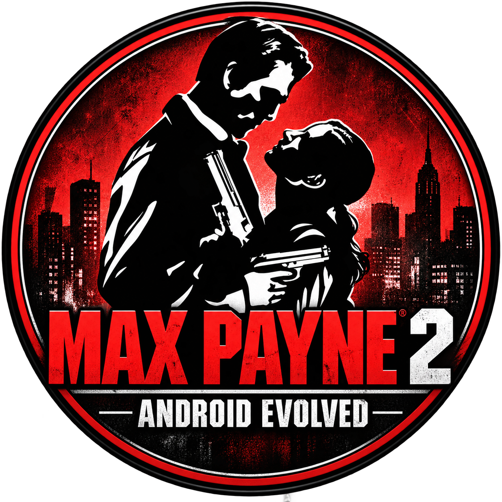

<p align="center">
  
</p>

<h1 align="center">Max Payne 2: Android Evolved</h1>

<p align="center">
  <b>Port nativo y experimental de Max Payne 2 (PC) a Android ARM64 mediante recompilación estática.</b><br>
  <a href="README.en.md">Read this in English</a>
</p>

> [!IMPORTANT]
> **Este repositorio no incluye el juego.** Necesitas tu propia copia de la versión de PC. No contiene
> ejecutables, DLL, archivos `.ras`, vídeos, audio ni código recompilado, y la APK tampoco los lleva.

## Qué es

El proyecto traduce el código x86 del juego de PC a C, lo compila para ARM64 y lo ejecuta en Android
sobre un runtime Win32 propio. No usa Wine, Box64, Winlator ni QEMU: la lógica, la física, los niveles y
el Bullet Time son los del juego original, no reimplementaciones.

```
Juego de PC x86 → PCRecomp → C → runtime Win32 propio → Android NDK ARM64 → DXVK/Vulkan → APK nativa
```

- **Gráficos:** Direct3D 8 → frontend D3D8 de DXVK → D3D9 de DXVK-native → Vulkan.
- **Sonido:** DirectSound → mezclador propio → AAudio.
- **Panorámico:** el WidescreenFix de ThirteenAG se ejecuta recompilado, como en PC.

## Estado

**Experimental. Se ha jugado en un solo dispositivo:** Samsung Galaxy S25 Ultra (SM-S938B, Adreno 830, 2340×1080).

| Área | Estado |
|---|---|
| Arranque y vídeos Bink de inicio | Funciona |
| Menú principal en español | Funciona; unos 30 s hasta el menú |
| Novela gráfica y primera cinemática | Funciona, con WidescreenFix |
| Primer nivel: caminar y mover la cámara | Funciona a 60 FPS |
| Sonido del motor | El mezclador reproduce voces; sin evaluación detallada de la calidad |
| HUD táctil y cursor en menús | Funciona |
| Launcher, idiomas y editor de controles | Implementado; prueba incompleta |
| Disparo, Bullet Time, Shootdodge | Implementado; **sin confirmar** |
| Guardar y cargar partida | "Reanudar" carga una partida guardada; **guardar sin confirmar** |
| Campaña completa | **Sin probar** |

Detalle técnico en [docs/PROGRESS.md](docs/PROGRESS.md) y bloqueos en [docs/BLOCKERS.md](docs/BLOCKERS.md).

## Requisitos para jugar

- Android 10 o superior (API 29), ARM64 y Vulkan 1.1. Solo se ha probado en Vulkan 1.3.
- Tu copia de Max Payne 2 para PC, en concreto la misma versión con la que se generó el código
  (las huellas SHA-256 están en [config/pc/modules.json](config/pc/modules.json)).
- `scripts/MaxPayne2.WidescreenFix.asi` y su `.ini`, de la misma versión, para el panorámico.
- Unos 1,5 GB libres en la memoria interna.

### Instalación

1. Copia la carpeta del juego a **Memoria interna/`mp2`**, de modo que exista `mp2/MaxPayne2.exe`:
   ```
   adb push "Max Payne 2 The Fall of Max Payne/." /storage/emulated/0/mp2/
   ```
2. Instala la APK. Hoy hay que compilarla: el proyecto no publica versiones.
3. Abre la app, concede el permiso de archivos y pulsa **JUGAR**.

## Controles táctiles

Cada botón envía la tecla o el botón de ratón que el juego tiene asignado de fábrica.

| Control | Acción en el juego |
|---|---|
| Joystick | Moverse (W, A, S, D) |
| Arrastrar en el resto de la pantalla | Mirar |
| Pistola | Disparar |
| Reloj de arena | Bullet Time |
| Salto lateral | Shootdodge (Mayús izquierda) |
| Salto / Recarga / Mano | Saltar / Recargar / Usar |
| Analgésicos / Armas / Mira | Analgésicos / Arma siguiente / Zoom de francotirador |
| Pausa | Esc: menú y saltar cinemáticas |

Los botones solo aparecen en gameplay, salvo Pausa, que está siempre visible. Fuera del gameplay un toque
cuenta como clic. El botón **Controles** permite moverlos y cambiarles el tamaño durante la partida, y también
se puede hacer desde el launcher.

## Compilar desde el código

Solo se ha compilado en Windows. Hacen falta Python 3 (`requirements-tools.txt`), Visual Studio con MSVC y CMake,
Android SDK con NDK `28.2.13676358` y CMake `3.30.5`, y el JDK de Android Studio: Gradle 8.9 no funciona con Java 26.

Algunas dependencias aún no se pueden obtener solo con este repositorio:

- **PCRecomp** en `external/pcrecomp`: rama y commit en [config/pc/toolchain.json](config/pc/toolchain.json), más
  `patches/pcrecomp/0001-seh-frames-and-or-xor-conditions.patch`.
- **Port de DXVK** en `work/pc/dxvk_android`: `scripts/pc_recomp/prepare_dxvk_android.sh` lo saca de una copia local de
  `nfsu2-recompiled`, un proyecto hermano que no forma parte de este repositorio.

Con la instalación del juego en `Max Payne 2 The Fall of Max Payne/`:

```powershell
# 1. Generar el código recompilado en work/pc/gen (no se sube nunca)
python scripts\pc_recomp\recompile_modules.py --phase all
python scripts\pc_recomp\merge_dispatch.py work\pc\gen\merged

# 2. Opcional: comprobar en Windows, en ventana de 960×540
powershell -File scripts\pc_recomp\boot_host.ps1 -Log prueba -AllowWindow -Widescreen

# 3. Compilar la APK
cd android
$env:JAVA_HOME = "C:\Program Files\Android\Android Studio\jbr"
.\gradlew --no-daemon :app:assembleDebug
```

La primera compilación ARM64 tardó unos 13 minutos en una máquina de 16 núcleos, con 8 trabajos en paralelo.

## Qué falta por probar

**Jugabilidad**
- [ ] Disparo, recarga y cambio de arma, con daño a enemigos.
- [ ] Bullet Time y Shootdodge reales, incluidas las animaciones y el medidor.
- [ ] Analgésicos, salto, uso de objetos y zoom de francotirador.
- [ ] Inteligencia artificial, física de objetos y muñecos de trapo en combate.
- [ ] Campaña completa, cambios de nivel y final.
- [ ] Modos extra: Serie negra, Un minuto en Nueva York, etc.

**Partidas y sistema**
- [ ] Guardar, autoguardado y cargar tras cerrar la app.
- [ ] Menú de opciones del juego: vídeo, audio y controles.
- [ ] Salir y volver a la app en plena partida, y cerrar desde el menú.
- [ ] Vídeos `previously.bik` y `credits.bik`.
- [ ] Sesiones largas: temperatura, batería, memoria y estabilidad.

**Launcher y controles**
- [ ] Editor de controles en el launcher y durante la partida.
- [ ] Cambio de idioma. Inglés oculta `MP2_Spanish.ras` y debería mostrar el idioma base, sin confirmar.
- [ ] Resolución, límite de FPS, campo de visión y opciones del panorámico.
- [ ] Qué hacen de verdad `-skipstartup` ("Saltar vídeos") y `-disable3dpreloads` ("Carga rápida").

**Compatibilidad**
- [ ] Otros teléfonos y GPU: Mali, Xclipse, Adreno antiguas.
- [ ] Dispositivos con exactamente Vulkan 1.1 y otras relaciones de aspecto.
- [ ] HUD del juego y cinemáticas en todas las escenas con el WidescreenFix.

## Qué falta por implementar

**Controles**
- [ ] **Mando físico:** el código nativo existe, pero falta conectarlo desde Java.
- [ ] Botones táctiles para agacharse, ataque cuerpo a cuerpo, arma anterior y selección directa de arma.
- [ ] Teclado en pantalla para escribir texto en el juego, si lo pide.
- [ ] Reasignar acciones y perfiles de controles.

**Sonido**
- [ ] DirectSound 3D completo: hoy hay atenuación por distancia y panorama, pero no Doppler, conos ni factores.
- [ ] Reverberación EAX: el motor recibe "no soportado".

**Idioma**
- [ ] Portugués dentro del juego: requiere datos de ese idioma, que esta copia no trae. El launcher sí está traducido.

**App y distribución**
- [ ] Publicar APK firmada y versiones.
- [ ] Asistente para copiar el juego y comprobar que la versión es correcta, con mensajes de error claros.
- [ ] Selector de carpeta del juego; hoy la ruta es fija.
- [ ] Controladores Vulkan personalizados, desactivados en esta compilación.

**Técnico**
- [ ] Rendimiento de carga: la CRT y la entrada/salida siguen recompiladas o emuladas.
- [ ] x87 de 80 bits: el modelo usa `double` de 64 bits, y puede afectar a la física en casos límite.
- [ ] Revisar las divergencias x87 pendientes de `msvcr71` ([docs/BLOCKERS.md](docs/BLOCKERS.md)).
- [ ] Diálogos Win32 y dibujo GDI: no existen en Android; el diálogo de inicio se evita con ajustes predefinidos.
- [ ] Retirar del runtime el código heredado del port de NFS Carbon que no se usa, como la red y NFSCO.
- [ ] Compilación reproducible sin depender del proyecto hermano, y pruebas automáticas en el dispositivo.
- [ ] Actualizar la documentación antigua de `docs/`, parte de ella anterior al port de Android.

## Estructura del repositorio

| Ruta | Contenido |
|---|---|
| `android/` | App: launcher, HUD y runtime nativo (`app/src/main/cpp`) |
| `desktop/pc_host/` | Host de Windows para validar y diagnosticar en PC |
| `scripts/pc_recomp/`, `scripts/pc_analysis/` | Recompilación y análisis de binarios |
| `config/pc/` | Módulos, parches del plugin y guiones de entrada |
| `src/runtime/pc/` | Código compartido entre hosts |
| `third_party/dxvk_d3d8/` | Frontend D3D8 de DXVK (licencia zlib) |
| `archive/ps2_reference/` | Intento anterior con la versión de PS2 ([README](archive/ps2_reference/README_PS2.md)) |
| `work/` | Generado en local a partir del juego; ignorado por Git |

## Créditos y aviso legal

Proyecto de aficionados sin relación con Remedy Entertainment ni Rockstar Games, ni respaldado por ellos.
*Max Payne* y sus recursos pertenecen a sus respectivos titulares.

Se apoya en [PCRecomp](https://github.com/sp00nznet/pcrecomp), [DXVK](https://github.com/doitsujin/dxvk) y el
WidescreenFix de [ThirteenAG](https://github.com/ThirteenAG/WidescreenFixesPack). El runtime parte de un port de
*Need for Speed Carbon*. Cada componente conserva su propia licencia.
