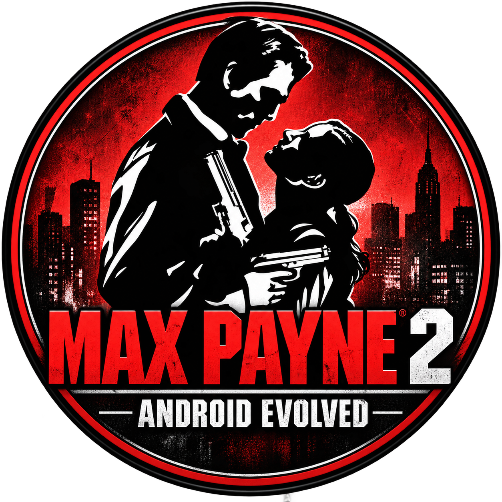

<p align="center">
  
</p>

<h1 align="center">Max Payne 2: Android Evolved</h1>

<p align="center">
  <b>Port nativo y experimental de Max Payne 2 (PC) a Android ARM64 mediante recompilación estática.</b><br>
  <a href="README.en.md">Read this in English</a>
</p>

> [!IMPORTANT]
> **Este repositorio no incluye el juego.** Necesitas tu propia copia de la versión de PC. No contiene
> ejecutables, DLL, archivos `.ras`, vídeos, audio ni código recompilado del juego de PC. La APK incluye el
> código recompilado enlazado al runtime nativo, pero no los archivos de datos del juego.

## Qué es

El proyecto traduce el código x86 del juego de PC a C, lo compila para ARM64 y lo ejecuta en Android
sobre un runtime Win32 propio. No usa Wine, Box64, Winlator ni QEMU: la lógica, la física, los niveles y
el Bullet Time son los del juego original, no reimplementaciones.

```
Juego de PC x86 → PCRecomp → C → runtime Win32 propio → Android NDK ARM64 → DXVK/Vulkan → APK nativa
```

- **Gráficos:** Direct3D 8 → frontend D3D8 de DXVK → D3D9 de DXVK-native → Vulkan.
- **Sonido:** DirectSound → mezclador propio → AAudio.
- **Panorámico:** el WidescreenFix de ThirteenAG se ejecuta recompilado, como en PC.

## Descarga

**[Descargar APK 0.23-pc para ARM64](https://github.com/codepdbh/mp2-androidevolved/releases/download/v0.23-pc/MaxPayne2-AndroidEvolved-0.23-pc-arm64-v8a.apk)** | [Notas del release y SHA-256](https://github.com/codepdbh/mp2-androidevolved/releases/tag/v0.23-pc)

Release 0.23-pc, con APK firmadas para ARM64 y ARM32. El port sigue siendo experimental. Se verificaron la firma, la versión y la alineación
del paquete; esta compilación Release todavía no se ha probado en un dispositivo. Las pruebas de juego
que se describen abajo corresponden a compilaciones anteriores de desarrollo.

Esta versión incorpora correcciones de los issues, validación de datos y WidescreenFix, contador FPS,
perfil ligero, ajustes del HUD y controles adicionales. Incluye la corrección nativa del SIGBUS de ARM32.
Consulta el [detalle de cambios y problemas pendientes](docs/ISSUES_2026-11-20.md).

### ARM32: totalmente experimental

[Descargar APK experimental de 32 bits](https://github.com/codepdbh/mp2-androidevolved/releases/download/v0.23-pc/MaxPayne2-AndroidEvolved-0.23-pc-armeabi-v7a-experimental.apk).
**Puede no arrancar o cerrarse durante la carga. No se ha probado en un dispositivo.**
Requiere Android 10 o superior, soporte de aplicaciones `armeabi-v7a` y un controlador Vulkan de 32 bits
compatible con Vulkan 1.1. No todos los teléfonos ARM64 permiten ejecutar aplicaciones ARM32.
El espacio de direcciones del juego queda limitado a 1 GB; no es una alternativa confirmada para teléfonos antiguos.
Usa el mismo paquete y firma que ARM64: conserva tus datos antes de cambiar de variante.

## Estado

**Experimental. Se ha jugado en un solo dispositivo:** Samsung Galaxy S25 Ultra (SM-S938B, Adreno 830, 2340×1080).

| Área | Estado |
|---|---|
| Arranque y vídeos Bink de inicio | Funciona |
| Menú principal en español | Funciona; unos 30 s hasta el menú |
| Novela gráfica y primera cinemática | Funciona, con WidescreenFix |
| Primer nivel: caminar y mover la cámara | Funciona a 60 FPS |
| Sonido del motor | El mezclador reproduce voces; sin evaluación detallada de la calidad |
| HUD táctil y cursor en menús | Funciona |
| Launcher, idiomas y editor de controles | Implementado; prueba incompleta |
| Disparo, Bullet Time, Shootdodge | Implementado; **sin confirmar** |
| Guardar y cargar partida | "Reanudar" carga una partida guardada; **guardar sin confirmar** |
| Campaña completa | **Sin probar** |

Detalle técnico en [docs/PROGRESS.md](docs/PROGRESS.md) y bloqueos en [docs/BLOCKERS.md](docs/BLOCKERS.md).

## Requisitos para jugar

- Android 10 o superior (API 29), ARM64 y Vulkan 1.1. Solo se ha probado en Vulkan 1.3.
- Tu copia de Max Payne 2 para PC, en concreto la misma versión con la que se generó el código
  (las huellas SHA-256 están en [config/pc/modules.json](config/pc/modules.json)).
- `scripts/MaxPayne2.WidescreenFix.asi` y su `.ini`, de la misma versión, para el panorámico.
- Espacio para tu instalación completa y la app. La copia usada en las pruebas ocupa unos 1,7 GB;
  se recomiendan al menos **3 GB libres** antes de copiar e instalar.

## Instalar la app y copiar los datos de tu juego

### 1. Preparar tu copia original en el PC

Instala tu copia original de **Max Payne 2 para Windows** desde el disco o la tienda donde la compraste.
Localiza la carpeta instalada que contiene `MaxPayne2.exe`, los archivos `.ras` y las DLL del motor.
Necesitas los archivos ya instalados: copiar el instalador, un ZIP sin extraer o una ISO no prepara los datos.
Los datos de PS2 o Xbox no sirven para esta versión del port.

La recompilación actual corresponde a los binarios descritos en [config/pc/modules.json](config/pc/modules.json).
No todas las ediciones, actualizaciones o ejecutables modificados son compatibles. Puedes comparar tu ejecutable
en PowerShell, desde la carpeta del juego:

```powershell
Get-FileHash .\MaxPayne2.exe -Algorithm SHA256
```

La huella del ejecutable usado para esta release es:

```text
1e25cafc37174a607b58a38dfac796056f0f38f35d253b0b2d7677f9bd7bd010
```

Para el modo panorámico, la app espera `scripts/MaxPayne2.WidescreenFix.asi` **de 2016** y su `.ini`.
El proyecto del mod está en [ThirteenAG/WidescreenFixesPack](https://github.com/ThirteenAG/WidescreenFixesPack/releases/tag/mp2),
pero su descarga actual puede ser distinta: comprueba la huella de la versión compatible en `config/pc/modules.json`.
No se garantiza que los paquetes recientes de mods funcionen con este código recompilado.
Si no tienes el fix compatible, desactiva **WidescreenFix** en el launcher; el modo sin él tiene limitaciones
de aspecto y no equivale a la configuración panorámica probada.

### 2. Copiar por USB al almacenamiento interno

1. Conecta el celular al PC y elige **Transferencia de archivos** en la conexión USB.
2. Abre el almacenamiento interno del celular y crea una carpeta llamada **`mp2`** en su raíz.
3. Copia **todo el contenido de la carpeta instalada del juego** dentro de `mp2`, conservando nombres
   y subcarpetas. Incluye las DLL, todos los `.ras` de tu instalación y las carpetas `e2driver`, `movies`
   y `scripts` cuando estén presentes. No copies solo el `.exe`.
4. Espera a que termine la transferencia. `MaxPayne2.exe` debe quedar directamente dentro de `mp2`.

Ejemplo de estructura esperada; conserva también los demás archivos de tu instalación:

```text
Memoria interna/
└── mp2/
    ├── MaxPayne2.exe
    ├── e2mfc.dll
    ├── ... otras DLL del juego ...
    ├── MP2_Init.ras
    ├── MP2_Data.ras
    ├── MP2_Levels_A.ras
    ├── MP2_Levels_B.ras
    ├── MP2_Levels_C.ras
    ├── MP2_Music.ras
    ├── MP2_Sounds.ras
    ├── MP2_Spanish.ras             ← si tu copia incluye español
    ├── e2driver/
    │   └── e2_d3d8_driver_mfc.dll
    ├── movies/
    └── scripts/
        ├── MaxPayne2.WidescreenFix.asi
        └── MaxPayne2.WidescreenFix.ini
```

La ruta Android exacta es **`/storage/emulated/0/mp2/MaxPayne2.exe`**.
Evita una carpeta extra como `mp2/Max Payne 2 The Fall of Max Payne/MaxPayne2.exe`.
La carpeta debe estar en la memoria interna compartida, no en `Android/data` ni dentro de Descargas.
Conserva los archivos de idioma que traiga tu copia: elegir otro idioma en el launcher no descarga sus datos.
Si ya tienes una carpeta `mp2` con partidas o ajustes, haz una copia de seguridad antes de reemplazar archivos.

**Alternativa con ADB**, si ya tienes Platform Tools y depuración USB habilitada:

```powershell
adb shell mkdir -p /storage/emulated/0/mp2
# Sustituye esta ruta por la carpeta instalada de tu copia original.
adb push "C:/Juegos/Max Payne 2 The Fall of Max Payne/." /storage/emulated/0/mp2/
adb shell ls /storage/emulated/0/mp2/MaxPayne2.exe
```

### 3. Instalar la APK y arrancar

1. Descarga la **APK ARM64** desde la [release 0.23-pc](https://github.com/codepdbh/mp2-androidevolved/releases/tag/v0.23-pc).
   Usa ARM32 solo si necesitas esa arquitectura y aceptas sus límites experimentales.
2. Abre la APK en el celular e instálala. Android puede pedir permiso para instalar aplicaciones desde
   el navegador o administrador de archivos que estés usando.
3. Abre **Max Payne 2: Android Evolved**, pulsa **JUGAR** y concede el permiso de acceso a archivos que solicite.
   En Android 11 o superior se usa el permiso de acceso a todos los archivos para leer la carpeta `mp2`.
4. Vuelve a la app, revisa que encuentre `Memoria interna/mp2` y pulsa **JUGAR**.
   Selecciona un idioma que exista en tu copia y deja activado WidescreenFix solo si copiaste la versión compatible.

En el código actual, al pulsar **JUGAR** se comprueban archivos esenciales y la huella SHA-256 del
ejecutable. Con WidescreenFix activado también se comprueban su `.asi` compatible y su `.ini`.
Si el fix falta o no coincide, puedes corregirlo o elegir **Jugar sin el fix**. Esta revisión no
verifica el contenido completo de los archivos `.ras`; el juego comprueba otros datos al arrancar.
Estas comprobaciones están incluidas desde 0.23-pc.

Si Android rechaza la actualización por una firma distinta a la de una APK de desarrollo, conserva tus datos
y desinstala esa APK antes de instalar el release. En el release encontrarás `SHA256SUMS.txt` para verificar la descarga.

### Si no arranca

| Mensaje o problema | Qué revisar |
|---|---|
| No encuentra `mp2/MaxPayne2.exe` | Ruta exacta, carpeta extra y permiso de archivos. |
| «Falta en la carpeta mp2…» | Vuelve a copiar el archivo indicado desde tu instalación completa; conserva `e2driver`. |
| «MaxPayne2.exe no coincide con el código recompilado» | Comprueba la versión y huellas de `config/pc/modules.json`; otra edición puede no ser compatible. |
| Error de WidescreenFix | Comprueba la versión de 2016, su `.asi` y `.ini` en `mp2/scripts`, o desactiva la opción para probar. |
| Falta un idioma, audio, vídeo o nivel | Comprueba que terminaron de copiarse todos los `.ras` y las subcarpetas de tu copia. |
| Cierre o pantalla negra después de estas comprobaciones | Abre **Errores** en el launcher y prepara un informe con el dispositivo, ajustes y log. |

## Informes de error

Desde 0.21-pc, el launcher permite preparar informes de error desde la sección **Errores**. En Android 11
o superior también puede avisar tras un cierre anómalo. Guarda el informe en `mp2/logs`, lo copia al
portapapeles y abre GitHub Issues para que lo revises y envíes; no se envía automáticamente.

## Controles táctiles

Cada botón envía la tecla o el botón de ratón que el juego tiene asignado de fábrica.

| Control | Acción en el juego |
|---|---|
| Joystick | Moverse (W, A, S, D) |
| Arrastrar en el resto de la pantalla | Mirar |
| Pistola | Disparar |
| Reloj de arena | Bullet Time |
| Salto lateral | Shootdodge (Mayús izquierda) |
| Salto / Recarga / Mano | Saltar / Recargar / Usar |
| Analgésicos / Armas / Mira | Analgésicos / Arma siguiente / Zoom de francotirador |
| Pausa | Esc: menú |
| Golpe / Agachar | F / C |
| F5 / F9 / Enter | Guardado rápido / Carga rápida / Continuar |
| Saltar / continuar (en escenas) | Espacio: continuar o saltar cinemáticas que el juego permite omitir |

Los botones de juego solo aparecen en gameplay. Pausa permanece visible y **Saltar / continuar** aparece
en escenas. Según el [soporte de Rockstar](https://support.rockstargames.com/articles/dotbJvVSSxPjelzzDTZTY/how-can-i-skip-the-cinematics-in-max-payne-2), las cinemáticas ya vistas se pueden omitir con Espacio o Usar.
Fuera del gameplay un toque
cuenta como clic. El botón **Controles** permite moverlos y cambiarles el tamaño durante la partida, y también
se puede hacer desde el launcher.

El código actual incorpora **Mostrar FPS**, que cuenta las presentaciones del juego, y un perfil
ligero de **67 % de resolución / 30 FPS**. Este perfil reduce la carga gráfica; no garantiza una
velocidad concreta en todos los dispositivos. Si al activar **HUD en los bordes** desaparece la salud,
reduce **Desplazamiento del HUD** o desactiva la opción. Consulta el [seguimiento de issues](docs/ISSUES_2026-11-20.md)
para distinguir correcciones verificadas localmente de problemas pendientes de reproducir en dispositivos.

## Compilar desde el código

Solo se ha compilado en Windows. Hacen falta Python 3 (`requirements-tools.txt`), Visual Studio con MSVC y CMake,
Android SDK con NDK `28.2.13676358` y CMake `3.30.5`, y el JDK de Android Studio: Gradle 8.9 no funciona con Java 26.

Algunas dependencias aún no se pueden obtener solo con este repositorio:

- **PCRecomp** en `external/pcrecomp`: rama y commit en [config/pc/toolchain.json](config/pc/toolchain.json), más
  `patches/pcrecomp/0001-seh-frames-and-or-xor-conditions.patch`.
- **Port de DXVK** en `work/pc/dxvk_android`: `scripts/pc_recomp/prepare_dxvk_android.sh` lo saca de una copia local de
  `nfsu2-recompiled`, un proyecto hermano que no forma parte de este repositorio.

Con la instalación del juego en `Max Payne 2 The Fall of Max Payne/`:

```powershell
# 1. Generar el código recompilado en work/pc/gen (no se sube nunca)
python scripts\pc_recomp\recompile_modules.py --phase all
python scripts\pc_recomp\merge_dispatch.py work\pc\gen\merged

# 2. Opcional: comprobar en Windows, en ventana de 960×540
powershell -File scripts\pc_recomp\boot_host.ps1 -Log prueba -AllowWindow -Widescreen

# 3. Compilar la APK
cd android
$env:JAVA_HOME = "C:\Program Files\Android\Android Studio\jbr"
.\gradlew --no-daemon :app:assembleDebug
```

La primera compilación ARM64 tardó unos 13 minutos en una máquina de 16 núcleos, con 8 trabajos en paralelo.

Para compilar la variante ARM32 experimental, ejecuta desde `android/`:

```powershell
.\gradlew --no-daemon -PexperimentalArm32=true :app:assembleRelease
```

Este comando genera un Release sin firmar si no configuras una clave de firma propia. La compilación
predeterminada sigue siendo ARM64; la APK publicada de ARM32 está firmada con la misma clave que la de ARM64.

## Qué falta por probar

**Jugabilidad**
- [ ] Disparo, recarga y cambio de arma, con daño a enemigos.
- [ ] Bullet Time y Shootdodge reales, incluidas las animaciones y el medidor.
- [ ] Analgésicos, salto, uso de objetos y zoom de francotirador.
- [ ] Inteligencia artificial, física de objetos y muñecos de trapo en combate.
- [ ] Campaña completa, cambios de nivel y final.
- [ ] Modos extra: Serie negra, Un minuto en Nueva York, etc.

**Partidas y sistema**
- [ ] Guardar, autoguardado y cargar tras cerrar la app.
- [ ] Menú de opciones del juego: vídeo, audio y controles.
- [ ] Salir y volver a la app en plena partida, y cerrar desde el menú.
- [ ] Vídeos `previously.bik` y `credits.bik`.
- [ ] Sesiones largas: temperatura, batería, memoria y estabilidad.

**Launcher y controles**
- [ ] Mando físico: implementado; falta validar sus acciones en un dispositivo.
- [ ] Editor de controles en el launcher y durante la partida.
- [ ] Cambio de idioma. Inglés oculta `MP2_Spanish.ras` y debería mostrar el idioma base, sin confirmar.
- [ ] Resolución, límite de FPS, campo de visión y opciones del panorámico.
- [ ] Qué hacen de verdad `-skipstartup` ("Saltar vídeos") y `-disable3dpreloads` ("Carga rápida").

**Compatibilidad**
- [ ] Otros teléfonos y GPU: Mali, Xclipse, Adreno antiguas.
- [ ] Dispositivos con exactamente Vulkan 1.1 y otras relaciones de aspecto.
- [ ] HUD del juego y cinemáticas en todas las escenas con el WidescreenFix.

## Qué falta por implementar

**Controles**
- [ ] Botones táctiles para agacharse, ataque cuerpo a cuerpo, arma anterior y selección directa de arma.
- [ ] Teclado en pantalla para escribir texto en el juego, si lo pide.
- [ ] Reasignar acciones y perfiles de controles.

**Sonido**
- [ ] DirectSound 3D completo: hoy hay atenuación por distancia y panorama, pero no Doppler, conos ni factores.
- [ ] Reverberación EAX: el motor recibe "no soportado".

**Idioma**
- [ ] Portugués dentro del juego: requiere datos de ese idioma, que esta copia no trae. El launcher sí está traducido.

**App y distribución**
- [x] Publicar APK firmada: [0.23-pc](https://github.com/codepdbh/mp2-androidevolved/releases/tag/v0.23-pc).
- [ ] Asistente para copiar el juego y comprobar que la versión es correcta, con mensajes de error claros.
- [ ] Selector de carpeta del juego; hoy la ruta es fija.
- [ ] Controladores Vulkan personalizados, desactivados en esta compilación.

**Técnico**
- [ ] Rendimiento de carga: la CRT y la entrada/salida siguen recompiladas o emuladas.
- [ ] x87 de 80 bits: el modelo usa `double` de 64 bits, y puede afectar a la física en casos límite.
- [ ] Revisar las divergencias x87 pendientes de `msvcr71` ([docs/BLOCKERS.md](docs/BLOCKERS.md)).
- [ ] Diálogos Win32 y dibujo GDI: no existen en Android; el diálogo de inicio se evita con ajustes predefinidos.
- [ ] Retirar del runtime el código heredado del port de NFS Carbon que no se usa, como la red y NFSCO.
- [ ] Compilación reproducible sin depender del proyecto hermano, y pruebas automáticas en el dispositivo.
- [ ] Actualizar la documentación antigua de `docs/`, parte de ella anterior al port de Android.

## Estructura del repositorio

| Ruta | Contenido |
|---|---|
| `android/` | App: launcher, HUD y runtime nativo (`app/src/main/cpp`) |
| `desktop/pc_host/` | Host de Windows para validar y diagnosticar en PC |
| `scripts/pc_recomp/`, `scripts/pc_analysis/` | Recompilación y análisis de binarios |
| `config/pc/` | Módulos, parches del plugin y guiones de entrada |
| `src/runtime/pc/` | Código compartido entre hosts |
| `third_party/dxvk_d3d8/` | Frontend D3D8 de DXVK (licencia zlib) |
| `archive/ps2_reference/` | Intento anterior con la versión de PS2 ([README](archive/ps2_reference/README_PS2.md)) |
| `work/` | Generado en local a partir del juego; ignorado por Git |

## Créditos y aviso legal

Proyecto de aficionados sin relación con Remedy Entertainment ni Rockstar Games, ni respaldado por ellos.
*Max Payne* y sus recursos pertenecen a sus respectivos titulares.

Se apoya en [PCRecomp](https://github.com/sp00nznet/pcrecomp), [DXVK](https://github.com/doitsujin/dxvk) y el
WidescreenFix de [ThirteenAG](https://github.com/ThirteenAG/WidescreenFixesPack). El runtime parte de un port de
*Need for Speed Carbon*. Cada componente conserva su propia licencia.
