# Dependencias entre módulos de Max Payne 2 (PC)

Generado por `scripts/pc_analysis/write_reports.py` a partir de las tablas de imports reales.

## Disposición de memoria invitada

Todas las DLL del motor piden `0x10000000`; cada una se recompila y se mapea en su propia base fija (`config/pc/modules.json`).

| Base invitada | SizeOfImage | Módulo |
|---|---:|---|
| `0x00400000` | `0x16da50` | `MaxPayne2.exe` |
| `0x00600000` | `0x56000` | `msvcr71.dll` |
| `0x00660000` | `0x7b000` | `msvcp71.dll` |
| `0x006e0000` | `0x103000` | `mfc71.dll` |
| `0x007f0000` | `0x61000` | `rlmfc.dll` |
| `0x00860000` | `0x1e000` | `grphmfc.dll` |
| `0x00880000` | `0x6a000` | `e2mfc.dll` |
| `0x008f0000` | `0x9000` | `T_GraphMFC.dll` |
| `0x00900000` | `0x5b000` | `KF2MFC.dll` |
| `0x00960000` | `0x1a000` | `PSysLibMFC.dll` |
| `0x00980000` | `0x1a000` | `sndmfc.dll` |
| `0x009a0000` | `0xd000` | `X_HelpersMFC.dll` |
| `0x009b0000` | `0x6e000` | `X_SharedDBMFC.dll` |
| `0x00a20000` | `0x21000` | `X_MessageMFC.dll` |
| `0x00a50000` | `0x14000` | `X_Inputmfc.dll` |
| `0x00a70000` | `0xd4000` | `X_PhysicalSimulationMFC.dll` |
| `0x00b50000` | `0x1f000` | `X_LevelMFC.dll` |
| `0x00b70000` | `0x1d000` | `X_LevelRuntimeMFC.dll` |
| `0x00b90000` | `0x37000` | `X_AudioMFC.dll` |
| `0x00bd0000` | `0x32000` | `X_ModesMFC.dll` |
| `0x00c10000` | `0x50000` | `X_BasicModesMFC.dll` |
| `0x00c60000` | `0x1d6000` | `X_GameObjectsMFC.dll` |
| `0x00e40000` | `0x72000` | `e2driver/binkw32.dll` |
| `0x00ec0000` | `0x87000` | `e2driver/e2_d3d8_driver_mfc.dll` |

Módulos que no se recompilan:

- `BugReport.exe`: informador de errores externo; no participa en el juego
- `SysInfo.dll`: solo la usa BugReport.exe
- `d3d9.dll`: cargador ASI de terceros, no es parte del juego
- `scripts/MaxPayne2.WidescreenFix.asi`: mod de terceros; se evalúa después de un arranque limpio
- `unins000.exe`: desinstalador
- `DirectX/dxwebsetup.exe`: instalador de DirectX
- `eax.dll`: sndmfc importa EAX por ordinal: pendiente de decidir puente nativo o lift
- `oleacc.dll`: dependencia de accesibilidad de mfc71; el motor no la importa

## Imports entre módulos

`N` son imports por nombre (C++ decorado) y `#N` por ordinal. El orden de esta tabla es el orden de DllMain, comprobado por `merge_dispatch.py`.

- **MaxPayne2.exe** → `KF2MFC.dll` 10, `sndmfc.dll` 26, `X_AudioMFC.dll` 26, `X_ModesMFC.dll` 202, `X_SharedDBMFC.dll` 102, `X_BasicModesMFC.dll` 57, `X_HelpersMFC.dll` 41, `X_LevelRuntimeMFC.dll` 61, `X_GameObjectsMFC.dll` 460, `PSysLibMFC.dll` 1, `X_LevelMFC.dll` 59, `X_MessageMFC.dll` 68, `e2mfc.dll` 151, `X_Inputmfc.dll` 47, `grphmfc.dll` 13, `X_PhysicalSimulationMFC.dll` 58, `rlmfc.dll` 138, `msvcp71.dll` 14, `mfc71.dll` 0 #192, `msvcr71.dll` 59
- **msvcr71.dll** → (nada del juego)
- **msvcp71.dll** → `msvcr71.dll` 93
- **mfc71.dll** → `msvcr71.dll` 105
- **rlmfc.dll** → `msvcp71.dll` 25, `mfc71.dll` 0 #16, `msvcr71.dll` 51
- **grphmfc.dll** → `rlmfc.dll` 24, `msvcp71.dll` 5, `mfc71.dll` 0 #2, `msvcr71.dll` 27
- **e2mfc.dll** → `grphmfc.dll` 15, `rlmfc.dll` 35, `mfc71.dll` 0 #4, `msvcr71.dll` 30, `msvcp71.dll` 5
- **T_GraphMFC.dll** → `rlmfc.dll` 17, `msvcp71.dll` 5, `mfc71.dll` 0 #2, `msvcr71.dll` 20
- **KF2MFC.dll** → `e2mfc.dll` 95, `grphmfc.dll` 3, `rlmfc.dll` 73, `mfc71.dll` 0 #4, `msvcr71.dll` 29, `msvcp71.dll` 7
- **PSysLibMFC.dll** → `e2mfc.dll` 68, `grphmfc.dll` 9, `T_GraphMFC.dll` 6, `rlmfc.dll` 36, `msvcp71.dll` 12, `mfc71.dll` 0 #3, `msvcr71.dll` 24
- **sndmfc.dll** → `e2mfc.dll` 26, `rlmfc.dll` 52, `msvcp71.dll` 11, `mfc71.dll` 0 #3, `msvcr71.dll` 25
- **X_HelpersMFC.dll** → `e2mfc.dll` 67, `grphmfc.dll` 2, `rlmfc.dll` 36, `msvcp71.dll` 11, `mfc71.dll` 0 #2, `msvcr71.dll` 21
- **X_SharedDBMFC.dll** → `rlmfc.dll` 61, `msvcp71.dll` 14, `mfc71.dll` 0 #2, `msvcr71.dll` 24
- **X_MessageMFC.dll** → `X_HelpersMFC.dll` 4, `rlmfc.dll` 29, `msvcp71.dll` 14, `mfc71.dll` 0 #2, `msvcr71.dll` 27
- **X_Inputmfc.dll** → `rlmfc.dll` 22, `msvcp71.dll` 11, `mfc71.dll` 0 #2, `msvcr71.dll` 20
- **X_PhysicalSimulationMFC.dll** → `X_SharedDBMFC.dll` 8, `X_HelpersMFC.dll` 1, `e2mfc.dll` 5, `rlmfc.dll` 51, `msvcp71.dll` 11, `mfc71.dll` 0 #2, `msvcr71.dll` 56
- **X_LevelMFC.dll** → `X_SharedDBMFC.dll` 12, `e2mfc.dll` 37, `grphmfc.dll` 7, `X_PhysicalSimulationMFC.dll` 18, `T_GraphMFC.dll` 4, `rlmfc.dll` 36, `msvcp71.dll` 12, `mfc71.dll` 0 #2, `msvcr71.dll` 23
- **X_LevelRuntimeMFC.dll** → `X_SharedDBMFC.dll` 3, `X_HelpersMFC.dll` 7, `X_LevelMFC.dll` 16, `e2mfc.dll` 34, `grphmfc.dll` 2, `X_PhysicalSimulationMFC.dll` 32, `rlmfc.dll` 31, `msvcp71.dll` 12, `mfc71.dll` 0 #2, `msvcr71.dll` 26
- **X_AudioMFC.dll** → `sndmfc.dll` 62, `X_SharedDBMFC.dll` 33, `X_HelpersMFC.dll` 3, `X_LevelRuntimeMFC.dll` 33, `X_LevelMFC.dll` 1, `X_MessageMFC.dll` 42, `e2mfc.dll` 22, `rlmfc.dll` 41, `msvcp71.dll` 13, `mfc71.dll` 0 #5, `msvcr71.dll` 30
- **X_ModesMFC.dll** → `sndmfc.dll` 5, `X_AudioMFC.dll` 12, `X_HelpersMFC.dll` 7, `X_MessageMFC.dll` 45, `e2mfc.dll` 26, `X_Inputmfc.dll` 5, `rlmfc.dll` 29, `msvcp71.dll` 13, `mfc71.dll` 0 #2, `msvcr71.dll` 25
- **X_BasicModesMFC.dll** → `sndmfc.dll` 7, `X_AudioMFC.dll` 2, `X_ModesMFC.dll` 33, `X_SharedDBMFC.dll` 3, `X_HelpersMFC.dll` 12, `X_LevelRuntimeMFC.dll` 1, `X_MessageMFC.dll` 63, `e2mfc.dll` 33, `X_Inputmfc.dll` 10, `grphmfc.dll` 3, `X_PhysicalSimulationMFC.dll` 2, `rlmfc.dll` 51, `msvcp71.dll` 17, `mfc71.dll` 0 #2, `msvcr71.dll` 29
- **X_GameObjectsMFC.dll** → `KF2MFC.dll` 64, `X_AudioMFC.dll` 35, `X_ModesMFC.dll` 30, `X_SharedDBMFC.dll` 318, `X_HelpersMFC.dll` 46, `X_LevelRuntimeMFC.dll` 85, `PSysLibMFC.dll` 25, `X_LevelMFC.dll` 72, `X_MessageMFC.dll` 68, `e2mfc.dll` 133, `grphmfc.dll` 9, `X_PhysicalSimulationMFC.dll` 191, `rlmfc.dll` 84, `msvcp71.dll` 14, `mfc71.dll` 0 #2, `msvcr71.dll` 41
- **binkw32.dll** → (nada del juego)
- **e2_d3d8_driver_mfc.dll** → `e2mfc.dll` 294, `grphmfc.dll` 7, `rlmfc.dll` 28, `binkw32.dll` 9, `mfc71.dll` 0 #4, `msvcr71.dll` 43, `msvcp71.dll` 4

## Grafo (capa de motor, sin CRT ni MFC)

```mermaid
graph TD
  MaxPayne2_exe --> KF2MFC_dll
  MaxPayne2_exe --> sndmfc_dll
  MaxPayne2_exe --> X_AudioMFC_dll
  MaxPayne2_exe --> X_ModesMFC_dll
  MaxPayne2_exe --> X_SharedDBMFC_dll
  MaxPayne2_exe --> X_BasicModesMFC_dll
  MaxPayne2_exe --> X_HelpersMFC_dll
  MaxPayne2_exe --> X_LevelRuntimeMFC_dll
  MaxPayne2_exe --> X_GameObjectsMFC_dll
  MaxPayne2_exe --> PSysLibMFC_dll
  MaxPayne2_exe --> X_LevelMFC_dll
  MaxPayne2_exe --> X_MessageMFC_dll
  MaxPayne2_exe --> e2mfc_dll
  MaxPayne2_exe --> X_Inputmfc_dll
  MaxPayne2_exe --> grphmfc_dll
  MaxPayne2_exe --> X_PhysicalSimulationMFC_dll
  MaxPayne2_exe --> rlmfc_dll
  grphmfc_dll --> rlmfc_dll
  e2mfc_dll --> grphmfc_dll
  e2mfc_dll --> rlmfc_dll
  T_GraphMFC_dll --> rlmfc_dll
  KF2MFC_dll --> e2mfc_dll
  KF2MFC_dll --> grphmfc_dll
  KF2MFC_dll --> rlmfc_dll
  PSysLibMFC_dll --> e2mfc_dll
  PSysLibMFC_dll --> grphmfc_dll
  PSysLibMFC_dll --> T_GraphMFC_dll
  PSysLibMFC_dll --> rlmfc_dll
  sndmfc_dll --> e2mfc_dll
  sndmfc_dll --> rlmfc_dll
  X_HelpersMFC_dll --> e2mfc_dll
  X_HelpersMFC_dll --> grphmfc_dll
  X_HelpersMFC_dll --> rlmfc_dll
  X_SharedDBMFC_dll --> rlmfc_dll
  X_MessageMFC_dll --> X_HelpersMFC_dll
  X_MessageMFC_dll --> rlmfc_dll
  X_Inputmfc_dll --> rlmfc_dll
  X_PhysicalSimulationMFC_dll --> X_SharedDBMFC_dll
  X_PhysicalSimulationMFC_dll --> X_HelpersMFC_dll
  X_PhysicalSimulationMFC_dll --> e2mfc_dll
  X_PhysicalSimulationMFC_dll --> rlmfc_dll
  X_LevelMFC_dll --> X_SharedDBMFC_dll
  X_LevelMFC_dll --> e2mfc_dll
  X_LevelMFC_dll --> grphmfc_dll
  X_LevelMFC_dll --> X_PhysicalSimulationMFC_dll
  X_LevelMFC_dll --> T_GraphMFC_dll
  X_LevelMFC_dll --> rlmfc_dll
  X_LevelRuntimeMFC_dll --> X_SharedDBMFC_dll
  X_LevelRuntimeMFC_dll --> X_HelpersMFC_dll
  X_LevelRuntimeMFC_dll --> X_LevelMFC_dll
  X_LevelRuntimeMFC_dll --> e2mfc_dll
  X_LevelRuntimeMFC_dll --> grphmfc_dll
  X_LevelRuntimeMFC_dll --> X_PhysicalSimulationMFC_dll
  X_LevelRuntimeMFC_dll --> rlmfc_dll
  X_AudioMFC_dll --> sndmfc_dll
  X_AudioMFC_dll --> X_SharedDBMFC_dll
  X_AudioMFC_dll --> X_HelpersMFC_dll
  X_AudioMFC_dll --> X_LevelRuntimeMFC_dll
  X_AudioMFC_dll --> X_LevelMFC_dll
  X_AudioMFC_dll --> X_MessageMFC_dll
  X_AudioMFC_dll --> e2mfc_dll
  X_AudioMFC_dll --> rlmfc_dll
  X_ModesMFC_dll --> sndmfc_dll
  X_ModesMFC_dll --> X_AudioMFC_dll
  X_ModesMFC_dll --> X_HelpersMFC_dll
  X_ModesMFC_dll --> X_MessageMFC_dll
  X_ModesMFC_dll --> e2mfc_dll
  X_ModesMFC_dll --> X_Inputmfc_dll
  X_ModesMFC_dll --> rlmfc_dll
  X_BasicModesMFC_dll --> sndmfc_dll
  X_BasicModesMFC_dll --> X_AudioMFC_dll
  X_BasicModesMFC_dll --> X_ModesMFC_dll
  X_BasicModesMFC_dll --> X_SharedDBMFC_dll
  X_BasicModesMFC_dll --> X_HelpersMFC_dll
  X_BasicModesMFC_dll --> X_LevelRuntimeMFC_dll
  X_BasicModesMFC_dll --> X_MessageMFC_dll
  X_BasicModesMFC_dll --> e2mfc_dll
  X_BasicModesMFC_dll --> X_Inputmfc_dll
  X_BasicModesMFC_dll --> grphmfc_dll
  X_BasicModesMFC_dll --> X_PhysicalSimulationMFC_dll
  X_BasicModesMFC_dll --> rlmfc_dll
  X_GameObjectsMFC_dll --> KF2MFC_dll
  X_GameObjectsMFC_dll --> X_AudioMFC_dll
  X_GameObjectsMFC_dll --> X_ModesMFC_dll
  X_GameObjectsMFC_dll --> X_SharedDBMFC_dll
  X_GameObjectsMFC_dll --> X_HelpersMFC_dll
  X_GameObjectsMFC_dll --> X_LevelRuntimeMFC_dll
  X_GameObjectsMFC_dll --> PSysLibMFC_dll
  X_GameObjectsMFC_dll --> X_LevelMFC_dll
  X_GameObjectsMFC_dll --> X_MessageMFC_dll
  X_GameObjectsMFC_dll --> e2mfc_dll
  X_GameObjectsMFC_dll --> grphmfc_dll
  X_GameObjectsMFC_dll --> X_PhysicalSimulationMFC_dll
  X_GameObjectsMFC_dll --> rlmfc_dll
  e2_d3d8_driver_mfc_dll --> e2mfc_dll
  e2_d3d8_driver_mfc_dll --> grphmfc_dll
  e2_d3d8_driver_mfc_dll --> rlmfc_dll
  e2_d3d8_driver_mfc_dll --> binkw32_dll
```

## Superficie nativa total

APIs fuera del juego que importan los módulos recompilados. Sin `mfc71.dll`, que por sí sola trae casi toda la superficie de USER32, GDI32, OLE y WinINet.

| DLL del sistema | Importadores |
|---|---|
| `ADVAPI32.DLL` | MaxPayne2.exe (1), mfc71.dll (15), e2_d3d8_driver_mfc.dll (3) |
| `COMCTL32.DLL` | mfc71.dll (17) |
| `COMDLG32.DLL` | mfc71.dll (11) |
| `DINPUT.DLL` | X_Inputmfc.dll (1) |
| `DSOUND.DLL` | sndmfc.dll (1) |
| `EAX.DLL` | sndmfc.dll (1) |
| `GDI32.DLL` | MaxPayne2.exe (9), mfc71.dll (111), grphmfc.dll (3), e2mfc.dll (1), binkw32.dll (12) |
| `KERNEL32.DLL` | MaxPayne2.exe (24), msvcr71.dll (154), msvcp71.dll (16), mfc71.dll (133), rlmfc.dll (41), grphmfc.dll (10), e2mfc.dll (19), T_GraphMFC.dll (10), KF2MFC.dll (10), PSysLibMFC.dll (10), sndmfc.dll (17), X_HelpersMFC.dll (10), X_SharedDBMFC.dll (10), X_MessageMFC.dll (10), X_Inputmfc.dll (11), X_PhysicalSimulationMFC.dll (12), X_LevelMFC.dll (10), X_LevelRuntimeMFC.dll (10), X_AudioMFC.dll (10), X_ModesMFC.dll (10), X_BasicModesMFC.dll (10), X_GameObjectsMFC.dll (12), binkw32.dll (66), e2_d3d8_driver_mfc.dll (18) |
| `ODBC32.DLL` | mfc71.dll (32) |
| `OLE32.DLL` | MaxPayne2.exe (2), mfc71.dll (78) |
| `OLEACC.DLL` | mfc71.dll (3) |
| `OLEAUT32.DLL` | MaxPayne2.exe (2), mfc71.dll (50) |
| `OLEDLG.DLL` | mfc71.dll (10) |
| `SHELL32.DLL` | MaxPayne2.exe (1), mfc71.dll (5) |
| `SHLWAPI.DLL` | mfc71.dll (6) |
| `URLMON.DLL` | mfc71.dll (4) |
| `USER32.DLL` | MaxPayne2.exe (32), mfc71.dll (205), rlmfc.dll (2), grphmfc.dll (4), e2mfc.dll (3), sndmfc.dll (1), X_Inputmfc.dll (6), X_GameObjectsMFC.dll (1), binkw32.dll (28), e2_d3d8_driver_mfc.dll (4) |
| `WININET.DLL` | mfc71.dll (39) |
| `WINMM.DLL` | rlmfc.dll (1), binkw32.dll (10) |
| `WINSPOOL.DRV` | mfc71.dll (4) |
| `WS2_32.DLL` | mfc71.dll (23) |
| `WSOCK32.DLL` | X_PhysicalSimulationMFC.dll (14) |

## Carga dinámica observada en las cadenas

- `e2mfc.dll` busca `e2driver\*_driver_mfc.dll` y `*_cpu_mfc.dll` y usa `LoadLibrary`; aquí solo existe `e2_d3d8_driver_mfc.dll` y ningún `*_cpu_mfc.dll`.
- `e2_d3d8_driver_mfc.dll` carga `D3D8.DLL` y resuelve `Direct3DCreate8` en ejecución: `d3d8.dll` no aparece como import estático. D3DX va enlazado estáticamente en el driver.
- `MaxPayne2.exe` contiene `D3D9.DLL` y exige un adaptador compatible con DirectX 9: pendiente de ver qué consulta hace.
- `sndmfc.dll` importa `DSOUND.dll` ordinal 2 y `EAX.DLL` ordinal 5.
- `X_Inputmfc.dll` importa `DirectInputCreateA` y `SetWindowsHookExA`, y lee `input.txt`.

